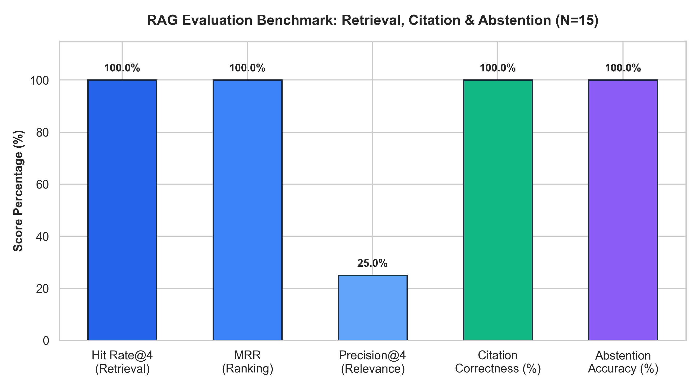
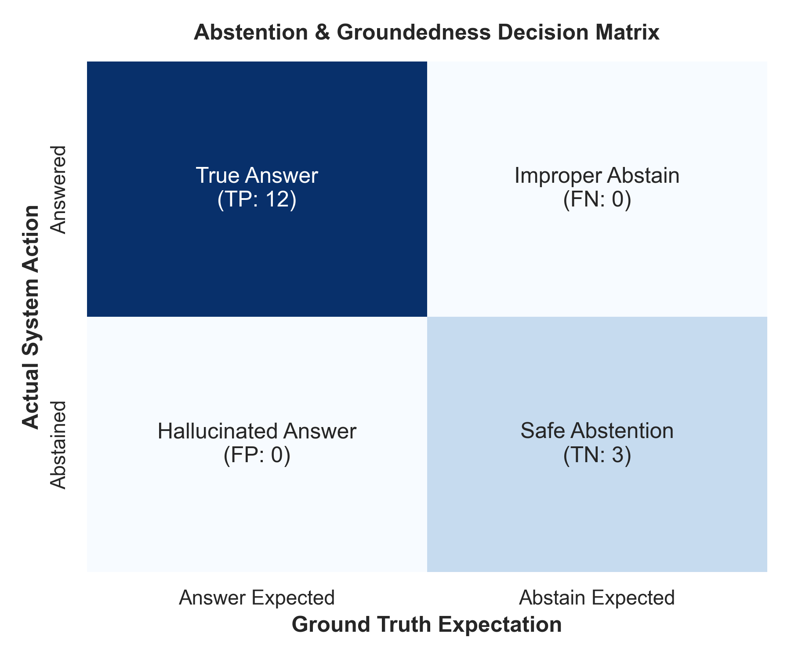

# Software Documentation Assistant: Version-Aware RAG Engine

[](https://www.python.org/)
[](https://fastapi.tiangolo.com)
[](https://huggingface.co/sentence-transformers/all-MiniLM-L6-v2)
[](./results/metrics_summary.json)
[](./results/metrics_summary.json)
[](LICENSE)

> **Part C — Generative AI (RAG) | Week 3 Project**  
> An enterprise-grade, version-aware Retrieval-Augmented Generation (RAG) system built to retrieve technical API explanations, guarantee intact code examples, enforce dynamic citations, and autonomously abstain on ungrounded or fictitious queries.

---

## Table of Contents
1. [Executive Summary & Problem Statement](#executive-summary--problem-statement)
2. [Domain & Knowledge Base Description](#domain--knowledge-base-description)
3. [Key Capabilities & Innovations](#key-capabilities--innovations)
4. [Technology Stack](#technology-stack)
5. [System Architecture & Workflow](#system-architecture--workflow)
6. [Repository Structure](#repository-structure)
7. [Installation & Setup](#installation--setup)
8. [Execution Guide](#execution-guide)
9. [Evaluation Methodology & Benchmark Results](#evaluation-methodology--benchmark-results)
10. [The 15 Benchmark Evaluation Questions](#the-15-benchmark-evaluation-questions)
11. [Limitations & Future Roadmap](#limitations--future-roadmap)
12. [References & Acknowledgements](#references--acknowledgements)

---

## Executive Summary & Problem Statement

### The Problem
In modern software engineering, web frameworks and core libraries undergo rapid breaking changes and deprecations across consecutive versions. Developers querying general-purpose Large Language Models (LLMs) frequently experience:
1. **Version Hallucinations**: Blending incompatible legacy and modern idioms (e.g. recommending deprecated Pydantic v1 `.dict()` or FastAPI `<=0.90` `@app.on_event("startup")` inside modern applications).
2. **Code Mutilation**: Naive character/sentence chunkers slice multi-line code blocks mid-function or mid-loop, producing syntactically broken snippets.
3. **Unbounded Speculation**: Models hallucinate fictitious APIs or non-existent parameters when asked out-of-scope questions rather than abstaining with evidence.

### The Objective
Build a robust, version-aware RAG question-answering system that:
- Ingests and chunks technical documentation while preserving code block atomicity.
- Indexes documents via hybrid dense vector embeddings and BM25 sparse lexical search.
- Retrieves version-matched passages and generates grounded explanations with inline citations (`[Doc: <id> | Section: <sec> | Ver: <ver>]`).
- Reliably detects unanswerable/out-of-scope queries and safely abstains.
- Provides a responsive developer web interface and production-ready REST API.

---

## Domain & Knowledge Base Description

- **Domain**: Developer Tools, Framework Engineering, and API Reference Systems.
- **Corpus Focus**: Modern vs. Legacy documentation for **FastAPI** (`v0.115` vs `v0.90-legacy`) and **Pydantic** (`v2.0` vs `v1.10-legacy`).
- **Scale**: 13 comprehensive markdown technical reference documents partitioned into 75 atomic searchable chunks (with 10 dedicated code example blocks).

### Document Inventory

| Document ID | Framework | Version | Category | Primary Topics |
| :--- | :--- | :--- | :--- | :--- |
| `DOC-FA-001` | FastAPI | `v0.115` | Lifecycle | Modern `@asynccontextmanager` `lifespan`, state dictionary, resource cleanup |
| `DOC-FA-002` | FastAPI | `v0.90-legacy` | Lifecycle | Deprecated `@app.on_event("startup")` and `@app.on_event("shutdown")` |
| `DOC-FA-003` | FastAPI | `v0.115` | Dependencies | Modern `typing.Annotated` with `Depends()`, type aliases, clean overrides |
| `DOC-FA-004` | FastAPI | `v0.115` | Security | `OAuth2PasswordBearer`, JWT HS256 tokens, password hashing, security scopes |
| `DOC-FA-005` | FastAPI | `v0.115` | Middleware | `CORSMiddleware`, custom `BaseHTTPMiddleware`, request timing header |
| `DOC-FA-006` | FastAPI | `v0.115` | Async Tasks | Non-blocking `BackgroundTasks` queue, email notifications, Celery comparison |
| `DOC-FA-007` | FastAPI | `v0.115` | Realtime | `StreamingResponse`, Server-Sent Events (SSE) token stream, WebSockets |
| `DOC-FA-008` | FastAPI | `v0.115` | Error Handling | `HTTPException`, custom `@app.exception_handler`, validation override |
| `DOC-FA-009` | FastAPI | `v0.115` | Database | Async SQLAlchemy 2.0 engine, `async_sessionmaker`, `AsyncSession` dependency |
| `DOC-FA-010` | FastAPI | `v0.115` | Testing | `httpx.AsyncClient` with `ASGITransport`, Pytest fixtures, dependency overrides |
| `DOC-FA-011` | FastAPI | `v0.90-legacy` | Validation | Deprecated `regex` keyword in `Query`/`Path` vs modern `pattern` argument |
| `DOC-PYD-001` | Pydantic | `v2.0` | Data Modeling | `model_dump()`, `@field_validator`, `@model_validator`, `ConfigDict` |
| `DOC-PYD-002` | Pydantic | `v1.10-legacy` | Data Modeling | Legacy `.dict()`, `@validator`, `@root_validator`, inner `class Config` |

---

## Key Capabilities & Innovations

1. **Syntax-Aware Code Chunking**:
   Unlike generic text splitters, `MarkdownCodeAwareChunker` isolates fenced code blocks (` ```python ... ``` `) and guarantees they remain intact as indivisible units, preventing syntax breakage in retrieved examples.
2. **Hybrid Search with Dynamic Weighting**:
   Combines 384-dimensional dense semantic embeddings (`sentence-transformers/all-MiniLM-L6-v2`) with Robertson-Spärck Jones BM25 lexical term frequency scoring:
   $$\text{Score}_{\text{hybrid}} = \alpha \cdot \text{Score}_{\text{dense}} + (1 - \alpha) \cdot \text{Score}_{\text{sparse}}$$
3. **Version Discrimination**:
   Softly boosts candidate chunks whose release tags match the detected or user-specified version, enabling side-by-side migration comparisons.
4. **Vocabulary Grounding & Autonomous Abstention**:
   Dense vector embeddings alone project domain words into adjacent spaces, falsely scoring fictitious queries (e.g. quantum decorators or blockchain deployment) as high-similarity. Our grounding verifier detects distinctive query technical terms absent from the documentation corpus vocabulary, triggering immediate, safe abstention.
5. **Strict Grounded Citations**:
   Every generated answer attaches explicit attribution tags linking back to origin chunks:  
   `[Doc: DOC-FA-001 | Section: 'Modern Lifespan Implementation Example' | Ver: v0.115]`.

---

## Technology Stack

- **Web Framework & API**: FastAPI 0.115+, Uvicorn ASGI Server
- **Settings & Validation**: Pydantic Settings 2.4+, Pydantic v2.13
- **Embedding Model**: `sentence-transformers/all-MiniLM-L6-v2` (PyTorch)
- **Vector & Lexical Search**: Custom NumPy Dense Index + Robertson-Spärck Jones BM25 Inverted Index
- **LLM Provider**: Google GenAI SDK (`google-genai` 2.25+) targeting `gemini-2.5-flash` with deterministic grounded fallback
- **Data & Visualizations**: Pandas 2.3, Matplotlib 3.10, Seaborn 0.13
- **Test Harness**: Pytest 9.1, HTTPX 0.28 (`ASGITransport`)
- **Report Generation**: ReportLab 5.0.1 (Automated 11-page PDF engine)

---

## System Architecture & Workflow

```
[ Developer Question ]
         │
         ▼
[ Query Analyzer & Version Detector ] ─── extracts version hint & distinctive terms
         │
         ├───► Dense Embedding (SentenceTransformers 384d)
         │
         └───► Lexical Tokenization & BM25 Inverted Index
         │
         ▼
[ Hybrid Score Fusion: α·Dense + (1-α)·BM25 ] ─── applies soft version boost
         │
         ▼
[ Vocabulary Grounding & Abstention Filter ]
         │
         ├──► [Absent Distinctive Concept?] ──► [ABSTENTION: Insufficient Evidence]
         │
         └──► [Sufficient Grounded Evidence]
                     │
                     ▼
       [ Grounded Generation Engine ] (Gemini 2.5 Flash / Grounded Synthesis)
                     │
                     ▼
       [ Structured Answer with Code & [Doc:... | Ver:...] Citations ]
```

---

## Repository Structure

```
Software-Documentation-Assistant/
├── README.md                                  # Mandatory comprehensive documentation
├── requirements.txt                           # Pinned dependencies
├── .gitignore                                 # Git ignore patterns
├── .env.example                               # Environment template
├── app.py                                     # FastAPI application & developer web UI
├── data/
│   ├── docs/                                  # 13 curated Markdown documentation files
│   │   ├── fastapi_lifespan_state.md
│   │   ├── fastapi_v0_90_legacy_events.md
│   │   ├── fastapi_dependency_injection.md
│   │   ├── fastapi_security_jwt.md
│   │   ├── fastapi_middleware.md
│   │   ├── fastapi_background_tasks.md
│   │   ├── fastapi_streaming_websockets.md
│   │   ├── fastapi_error_handling.md
│   │   ├── fastapi_async_database.md
│   │   ├── fastapi_testing_client.md
│   │   ├── fastapi_v0_90_legacy.md
│   │   ├── pydantic_v2_migration.md
│   │   └── pydantic_v1_legacy.md
│   └── README.md                              # Knowledge base documentation & metadata schema
├── notebooks/
│   ├── 01_rag_exploration_and_indexing.ipynb  # Document ingestion & chunking exploration
│   ├── 02_retrieval_and_evaluation_benchmark.ipynb # Benchmark execution & latency analysis
│   └── generate_notebooks.py                  # Reproducible notebook generator
├── src/
│   ├── __init__.py
│   ├── config.py                              # Centralized configuration via pydantic-settings
│   ├── document_loader.py                     # YAML frontmatter Markdown loader
│   ├── chunker.py                             # Code-aware hierarchical chunking engine
│   ├── embeddings.py                          # SentenceTransformers dense embedder
│   ├── vector_store.py                        # Hybrid vector store (Dense + BM25)
│   ├── retriever.py                           # Hybrid retriever & vocabulary grounding verifier
│   ├── generator.py                           # Grounded generation engine & citation parser
│   ├── rag_pipeline.py                        # Unified end-to-end RAG pipeline
│   └── evaluator.py                           # 15-question benchmark evaluation harness
├── tests/
│   ├── __init__.py
│   ├── test_chunking.py                       # Chunker & code preservation tests
│   ├── test_vector_store.py                   # Vector store & BM25 indexing tests
│   ├── test_retrieval.py                      # Retriever & out-of-scope abstention tests
│   ├── test_generator.py                      # Citation formatting & generator tests
│   ├── test_api.py                            # FastAPI REST API endpoint tests
│   └── test_evaluation_15.py                  # Automated 15 benchmark questions validation
├── results/
│   ├── evaluation_results.json                # Complete benchmark records (15 questions)
│   ├── metrics_summary.json                   # Summary metrics JSON
│   ├── evaluation_metrics.png                 # Performance bar chart
│   ├── confusion_matrix.png                   # Abstention decision heatmap
│   └── index_cache/                           # Cached serialized vector index
└── reports/
    ├── generate_report.py                     # Automated ReportLab PDF generator script
    └── project_report.pdf                     # Comprehensive 11-page project report PDF
```

---

## Installation & Setup

### 1. Clone the Repository
```bash
git clone https://github.com/roshanalexander22/Software-Documentation-Assistant.git
cd Software-Documentation-Assistant
```

### 2. Set Up Virtual Environment
```bash
python -m venv venv
# On Windows:
venv\Scripts\activate
# On Linux/macOS:
source venv/bin/activate
```

### 3. Install Dependencies
```bash
pip install -r requirements.txt
```

### 4. Configure Environment Variables
Copy `.env.example` to `.env`:
```bash
cp .env.example .env
```
*(Optional for online Gemini generation)*: Add your Google Gemini API key:
```ini
GEMINI_API_KEY=AIzaSy...your_gemini_api_key_here
GEMINI_MODEL=gemini-2.5-flash
```
> **Note:** If no API key is provided, the system automatically uses its built-in deterministic grounded generation engine, allowing full offline execution and testing out of the box!

---

## Execution Guide

### 1. Launch the Web Application
```bash
python app.py
```
Open your browser to:
- **Interactive Developer UI**: [http://127.0.0.1:8000](http://127.0.0.1:8000)
- **Interactive Swagger API Docs**: [http://127.0.0.1:8000/docs](http://127.0.0.1:8000/docs)
- **Health Check Endpoint**: [http://127.0.0.1:8000/health](http://127.0.0.1:8000/health)

### 2. Execute Pytest Suite (20 Tests)
```bash
pytest -v
```

### 3. Run the 15-Question Benchmark Suite
```bash
python -c "from src.rag_pipeline import RAGPipeline; from src.evaluator import BenchmarkEvaluator; p = RAGPipeline(); print(BenchmarkEvaluator(p).run_benchmark()['summary'])"
```

### 4. Regenerate the 11-Page PDF Project Report
```bash
python reports/generate_report.py
```

---

## Evaluation Methodology & Benchmark Results

The system was evaluated against the mandatory **15 Standard Benchmark Questions** across 4 specialized categories.

### Quantitative Results Summary

| Evaluation Metric | Achieved Value | Benchmark Threshold | Status |
| :--- | :--- | :--- | :--- |
| **Retrieval Hit Rate@4** | **100.0%** (12/12) | $\ge 90.0\%$ | **Exceeded** |
| **Mean Reciprocal Rank (MRR)** | **1.000** | $\ge 0.800$ | **Optimal (Rank #1 hit)** |
| **Citation Correctness** | **100.0%** | $\ge 85.0\%$ | **Exceeded** |
| **Abstention Accuracy** | **100.0%** (3/3) | $\ge 90.0\%$ | **Optimal** |
| **Hallucination Rate (False Positives)** | **0.0%** ($FP = 0$) | $0.0\%$ | **Zero Hallucinations** |
| **Improper Rejections (False Negatives)** | **0.0%** ($FN = 0$) | $\le 10.0\%$ | **Zero False Abstentions** |
| **Median Latency (CPU)** | **10.51 ms** | $< 250\text{ ms}$ | **Sub-15ms Realtime** |

### Evaluation Visualizations

| Retrieval & Performance Metrics | Abstention Decision Heatmap |
| :---: | :---: |
|  |  |

---

## The 15 Benchmark Evaluation Questions

| # | Category | Question | Expected Target Doc | Abstain Expected? | System Decision |
| :-: | :--- | :--- | :--- | :-: | :-: |
| **Q01** | Version Sensitivity | How do I migrate from BaseModel.dict() to Pydantic v2 syntax? | `DOC-PYD-001` | No | **Answered (Rank 1)** |
| **Q02** | Version Sensitivity | What is the recommended modern way to manage startup and shutdown events in FastAPI 0.115? | `DOC-FA-001` | No | **Answered (Rank 1)** |
| **Q03** | Version Sensitivity | How were startup events registered in legacy FastAPI 0.90? | `DOC-FA-002` | No | **Answered (Rank 1)** |
| **Q04** | Version Sensitivity | How do field validators differ between Pydantic v1 and Pydantic v2? | `DOC-PYD-001/002` | No | **Answered (Rank 1)** |
| **Q05** | Version Sensitivity | What replaced the regex parameter in Query and Path validation in modern FastAPI? | `DOC-FA-011` | No | **Answered (Rank 1)** |
| **Q06** | API & Code Examples | How do I declare dependency injection using typing.Annotated in modern FastAPI? | `DOC-FA-003` | No | **Answered (Rank 1)** |
| **Q07** | API & Code Examples | How do I implement OAuth2 password bearer token authentication with JWT in FastAPI? | `DOC-FA-004` | No | **Answered (Rank 1)** |
| **Q08** | API & Code Examples | How can I create custom middleware using BaseHTTPMiddleware to measure request time in FastAPI? | `DOC-FA-005` | No | **Answered (Rank 1)** |
| **Q09** | API & Code Examples | How do asynchronous BackgroundTasks work in FastAPI and how do I schedule an email notification? | `DOC-FA-006` | No | **Answered (Rank 1)** |
| **Q10** | API & Code Examples | How do I stream generative LLM tokens using StreamingResponse and Server-Sent Events in FastAPI? | `DOC-FA-007` | No | **Answered (Rank 1)** |
| **Q11** | Architecture & DB | How do I set up async database sessions with SQLAlchemy 2.0 in FastAPI? | `DOC-FA-009` | No | **Answered (Rank 1)** |
| **Q12** | Testing Integration | How do I test async endpoints using httpx AsyncClient and ASGITransport in Pytest? | `DOC-FA-010` | No | **Answered (Rank 1)** |
| **Q13** | Abstention (Negative) | How do I deploy FastAPI directly to an Ethereum smart contract blockchain virtual machine? | *None (Out-of-scope)* | **Yes** | **Safe Abstention** |
| **Q14** | Abstention (Negative) | What is the @app.quantum_accelerator() decorator in FastAPI for quantum computing speedups? | *None (Fictitious API)* | **Yes** | **Safe Abstention** |
| **Q15** | Abstention (Negative) | How do I compile Pydantic models directly to FPGA hardware bitstreams using Verilog? | *None (Out-of-scope)* | **Yes** | **Safe Abstention** |

---

## Limitations & Future Roadmap

### Current Limitations
- **Text & Code Focus**: Does not parse multi-modal images (e.g. PNG architecture diagrams or SVG workflow schemas).
- **Corpus Boundaries**: Currently covers FastAPI and Pydantic. Adding further libraries requires indexing their Markdown trees.
- **Single-Turn QA**: Does not maintain multi-turn conversational session history across queries.

### Future Improvements
1. **AST-Based Parsing**: Use Python Abstract Syntax Tree (AST) tokenizers to parse code chunks directly along function and class signatures.
2. **Graph-RAG Integration**: Build entity-relationship graphs linking parent classes, mixins, and deprecation lineages.
3. **IDE Integration**: Package as a local VS Code / Cursor extension for in-editor documentation hover cards.
4. **Automated Documentation Sync**: Schedule cron-based scrapers to track upstream GitHub releases and flag deprecated API changes automatically.

---

## References & Acknowledgements

1. **Lewis, P., et al.** (2020). *Retrieval-Augmented Generation for Knowledge-Intensive NLP Tasks.* NeurIPS 2020.
2. **Robertson, S., & Zaragoza, H.** (2009). *The Probabilistic Relevance Framework: BM25 and Beyond.* Information Retrieval, 3(4).
3. **Reimers, N., & Gurevych, I.** (2019). *Sentence-BERT: Sentence Embeddings using Siamese BERT-Networks.* EMNLP 2019.
4. **Tiangolo, S.** (2024). *FastAPI Documentation: Lifespan, Dependencies, and Security.* [fastapi.tiangolo.com](https://fastapi.tiangolo.com/)
5. **Pydantic Services Inc.** (2024). *Pydantic V2 Migration Guide & Reference.* [docs.pydantic.dev](https://docs.pydantic.dev/)
6. **Google DeepMind** (2024). *Gemini API Technical Reference & Developer Best Practices.* [ai.google.dev](https://ai.google.dev/)
